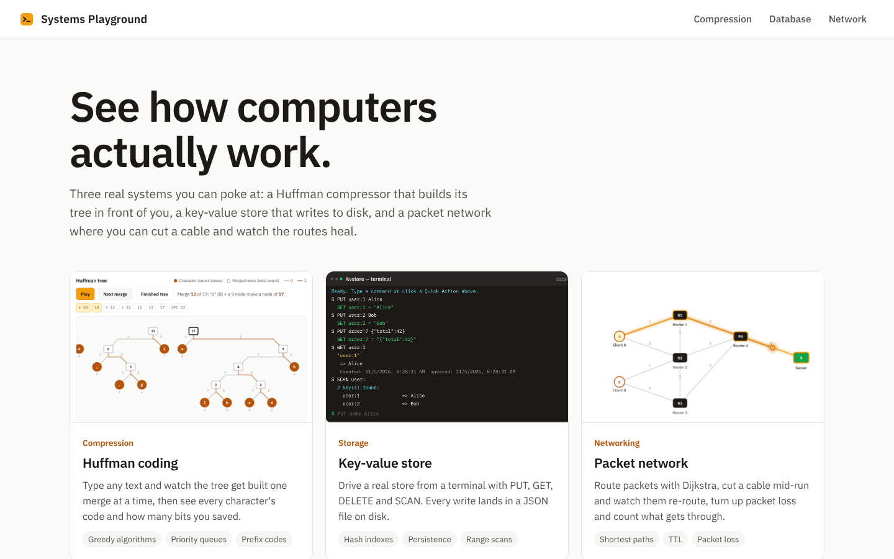
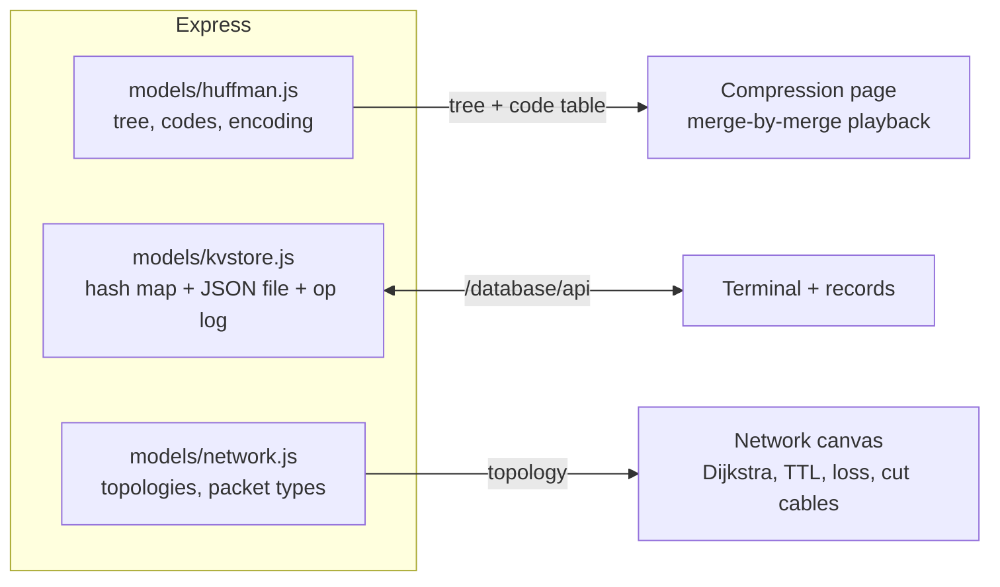

# Systems Playground

**Open the box.** Three real systems you can poke at: a Huffman compressor that builds its tree in front of you, a key-value store that writes every command to disk, and a packet network where you can cut a cable and watch the routes heal.


## Why it's interesting

- **Cut a cable mid-run.** Click any link in the network to take it down. Dijkstra recomputes the routing table, and a packet already in flight re-routes at the next router, or is dropped if no route is left. Turn up packet loss and send ten in a row to see what a lossy link does to a stream. A TTL-2 probe shows a packet running out of hops, the way traceroute works.
- **Watch the Huffman tree grow.** Every merge plays out with the priority queue shown above the forest: the two smallest counts get pulled, joined and pushed back. The playback runs the same algorithm as the server, so it ends on exactly the tree whose codes are in the table.
- **A database you can see on disk.** PUT, GET, DELETE, SCAN and STATS from a terminal, with an operation log next to it. Every write lands in `data/kvstore.json`.
- **Real implementations, not canned animations.** What you see is the actual algorithm running on your input.

| Home | Huffman, merge by merge | Key-value store |
|---|---|---|
|  |  |  |

## How it fits together



## Quick start

```bash
git clone https://github.com/Janat-Yasser/sysplay.git && cd sysplay
npm install
npm start
```

Open http://localhost:3000. The store file `data/kvstore.json` is created on first write and gitignored.

<details>
<summary>The three modules</summary>

| Ref | Module | Try this | Concepts |
|---|---|---|---|
| U1 | Huffman compression | Load the Dickens sample, then step through the merges. Watch the space character end up with a 2-bit code. | Greedy algorithms, priority queues, prefix-free codes |
| U2 | Key-value store | `PUT user:1 Alice`, `PUT user:2 Bob`, `SCAN user:`, then `STATS` | Hash indexing, persistence, why range scans want sorted storage |
| U3 | Packet network | Mesh topology: send a packet, cut R1 to R4, send again | Shortest-path routing, TTL, packet loss, redundancy |

</details>

<details>
<summary>Design</summary>

Warm and calm: stone-grey pages, near-black text, one amber accent (buttons, the Huffman tree's 1-branches, a packet's route), and green/yellow/red only where they mean delivered, waiting or dropped. The database module keeps a dark terminal because it is one. Type is IBM Plex Sans, with IBM Plex Mono for code, self-hosted in `public/fonts` (SIL Open Font License).

</details>

<details>
<summary>Project layout</summary>

```
server.js
models/huffman.js       Huffman tree, code table, compression stats
models/kvstore.js       file-backed key-value store with an operation log
models/network.js       topologies and packet types
models/controllers.js
routes/                 /compression, /database, /network
views/                  EJS pages
public/js/              compression.js (tree playback), database.js (terminal), network.js (canvas)
test/huffman.test.js    round-trip and prefix-free tests
```

</details>

## Roadmap

- An LRU cache module, with eviction shown
- A B-tree index for the key-value store, so SCAN stops being O(n)
- TCP: the three-way handshake and a congestion window

MIT licensed.
