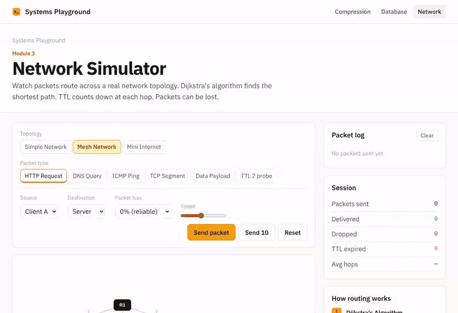

<div align="center">

# Systems Playground

**Three real systems, and how to break each one.**

[Live demo](https://janat-yasser.github.io/sysplay/) · [Run locally](#run-it) · [How the demo runs without a server](#one-codebase-two-ways-to-run)

[](https://github.com/Janat-Yasser/sysplay/actions/workflows/ci.yml)



</div>

---

### 01 · A packet network

Routers, hosts and cables on a canvas. Each packet follows a route that Dijkstra's algorithm computes from the current topology.

> **Break it:** on the [mesh network](https://janat-yasser.github.io/sysplay/network/mesh/), send a packet, then click the R1–R4 cable to cut it and send another. The routing table is recomputed. A packet that's already in flight re-routes at its next router, or is dropped if no route is left. Then turn packet loss up to 25% and send ten in a row.

You'll see shortest-path routing, why networks have redundant links, and TTL: a TTL-2 probe runs out of hops the way `traceroute` does.

### 02 · A Huffman compressor

Type any text and watch the code tree being built, one merge at a time, with the priority queue above it. The two smallest counts are pulled, joined and pushed back.

> **Break it:** compress `aaaaaaaabbbbcc` (82% smaller), then *the quick brown fox jumps over the lazy dog* (44%), then the 64 characters `a`–`z`, `0`–`9`, `A`–`Z`, `!?` once each (25%). With no character more common than another, every code is the same 6 bits, so all that's saved is the gap between 6 and 8.


### 03 · A key-value store

A small database driven from a terminal: `PUT`, `GET`, `DELETE`, `SCAN`, `STATS`, with an operation log alongside. Run locally, every write lands in `data/kvstore.json`.

> **Break it:** `PUT user:1 Alice`, `PUT user:2 Bob`, `PUT order:9 tea`, then `SCAN user:`. The store finds those keys by checking *every* key, because a hash map has no order. That O(n) scan is why real databases keep sorted indexes such as B-trees.


---

## One codebase, two ways to run

The models in `models/` are plain Node modules: `huffman.js`, `kvstore.js` and `network.js`.

- **Locally**, Express renders the pages and calls the models directly.
- **On GitHub Pages**, there's no server. `npm run build:static` renders every page with the real app, then wraps the *same, unchanged* model files for the browser:
  - the key-value store keeps its "file" in `localStorage`;
  - compression renders the same EJS template in the page;
  - the text goes in the URL, so you can share a result.

The compression ratio you get online is byte-for-byte the one the server computes.

## Run it

```bash
npm install
npm start               # http://localhost:3000
npm test                # Huffman round-trip and prefix-free tests
npm run build:static    # the Pages version, in dist/
```

**Design:** stone-grey pages and one amber accent; green, yellow and red appear only where they mean delivered, waiting or dropped. The database keeps a dark terminal because it is one. IBM Plex Sans and Mono, self-hosted (SIL OFL).

**Next:** an LRU cache with eviction shown, a B-tree index so `SCAN` stops being O(n), and a TCP handshake with a congestion window.

© 2026 Janat Yasser. All rights reserved. See [LICENSE](LICENSE).
