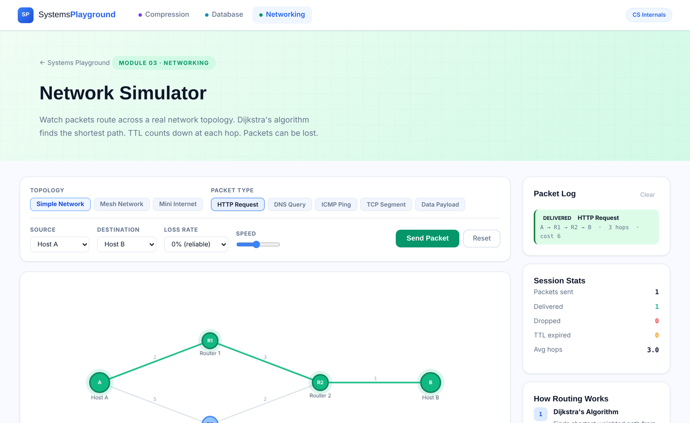
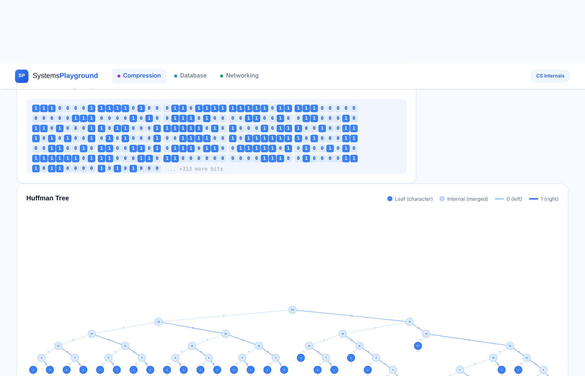
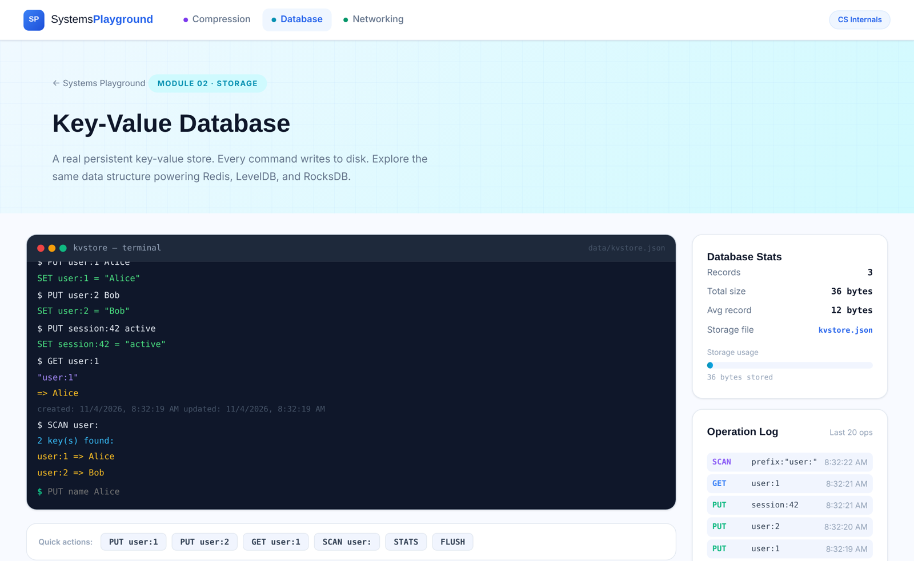

# Systems Playground

**See how computers actually work.**

Three interactive modules that open up the systems behind everyday computing: compression, storage engines and networking. These aren't canned animations. Each module runs a real implementation you can poke at.




---

## Modules

### 01 · Huffman Compression
Type any text and watch the Huffman tree build in real time. See which characters get short codes and which get long ones, and why. You can compare original and compressed size character by character. It's the same greedy idea behind ZIP.

*Concepts: greedy algorithms, priority queues, binary trees, entropy, variable-length encoding.*



### 02 · Key-Value Database
A real key-value store that persists to disk. Drive it from a terminal-style interface with `PUT`, `GET`, `DELETE`, `SCAN`, `STATS` and `FLUSH`, and watch the operation log and the JSON file on disk change as you go.

*Concepts: storage engines, persistence, hash-map indexing, operation logging, range scans.*



### 03 · Network Simulator
Send packets (HTTP, DNS, ICMP ping, TCP, data payloads) across an animated topology: a simple network, a mesh, or a "mini internet". Routing happens hop by hop using Dijkstra's shortest path. You can simulate packet loss, TTL expiry and congestion.

*Concepts: packet switching, shortest-path routing, TTL and hop counts, topologies.*

## Quick start

```bash
git clone https://github.com/Janat-Yasser/sysplay.git
cd sysplay
npm install
npm run dev
```

Open **http://localhost:3000**. The KV store writes to `data/kvstore.json`, which is created automatically and gitignored.

## Project structure

```
sysplay/
├── server.js
├── models/
│   ├── huffman.js       # Huffman tree + code table + compression stats
│   ├── kvstore.js       # File-backed key-value store with an operation log
│   ├── network.js       # Topologies + packet types
│   └── controllers.js
├── routes/              # /compression, /database, /network
├── views/               # One EJS page per module
└── public/js/           # Client-side visualizers
```

## Roadmap

- [ ] An LRU cache module (eviction visualized)
- [ ] A B-tree index for the KV store
- [ ] A TCP handshake and congestion-window module

## License

MIT
